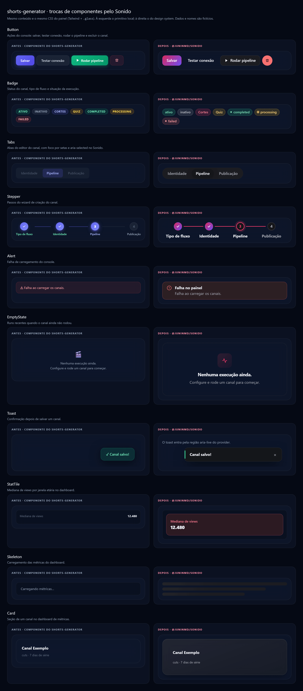

# Troca dos componentes locais pelo Sonido (`web/`)

O painel React do shorts-generator tinha os primitivos escritos à mão em `App.tsx`,
`features/` e `index.css` (classes `.btn`, `.badge`, `.tab`, `.step-*`). Esta pasta guarda a
comparação lado a lado usada na revisão da troca pelo
[`@juninmd/sonido`](https://github.com/juninmd/sonido) `^2.2.1`.



## O que foi trocado

| Componente   | Antes (shorts-generator)                                               | Depois (`@juninmd/sonido`)                                                        |
| ------------ | ---------------------------------------------------------------------- | --------------------------------------------------------------------------------- |
| `Button`     | `<button class="btn btn-brand\|btn-ghost\|btn-green\|btn-red">`         | `Button` (`primary`, `secondary`, `ghost`, `danger`, `size="icon"`)               |
| `Badge`      | `<span class="badge badge-green\|...">` (status via `badgeClass`)       | `Badge` (`success`, `neutral`, `accent`, `warning`, `danger`, `dot`, `live`)       |
| `Tabs`       | contêiner próprio + botões `.tab` / `.tab.active`                       | `Tabs variant="pill"` (role `tablist`, setas, Home/End, `aria-selected`)           |
| `Stepper`    | `WizardBar` com círculos e conectores desenhados no `App.tsx`           | `Stepper` (`current`, `aria-current="step"`)                                      |
| `Alert`      | `div` com `role="alert"` e cores inline em 5 arquivos                   | `Alert tone="danger"` (role `alert`), `tone="success"` (role `status`)             |
| `EmptyState` | blocos de emoji + frase no console, dashboard e cortes                  | `EmptyState` com título, descrição e ícone                                        |
| `Toast`      | `Toast` local + `setTimeout` no `App.tsx`                               | `ToastProvider` + `useToast()` (região `aria-live`, drenagem, fechar)              |
| `StatTile`   | linha `Row` "Mediana de views" no `WindowLeaderboard`                    | `StatTile label/tone`                                                             |
| `Skeleton`   | texto "Carregando métricas…" no dashboard                                | `Skeleton` com `role="status"`                                                    |
| `Card`       | `<section class="glass">` do dashboard                                   | `Card surface="glass"`                                                            |

Arquivos alterados: `web/src/App.tsx`, `web/src/components/{DashboardPage,MetricsSparkline,WindowLeaderboard}.tsx`,
`web/src/features/{ToolPage,ChannelWizard,CutsWorkspace,ScheduleBoard,RadarPanel,RadarMap}.tsx`,
`web/src/utils.ts`, `web/src/main.tsx`, `web/index.html`, `web/src/index.css`.

## Tema

O painel é escuro por definição. `web/src/main.tsx` importa `@juninmd/sonido/styles.css` antes de
`index.css` e fixa `document.documentElement.dataset.theme = "dark"`; `index.html` já nasce com
`data-theme="dark"` para evitar flash. Não há troca de tema em runtime (não existia antes).

## Ponte de layout (a única)

O CSS publicado do Sonido **não** está em `@layer`, então utilitários Tailwind não vencem
propriedades que o design system já define. Onde isso importava, a margem/alinhamento vem de um
wrapper ou de `style` inline (sem sobrescrever o visual do Sonido):

- `WizardBar`: wrapper com `marginBottom: 32` (`.sn-stepper` fixa `margin: 0`).
- Botões da sidebar: `justifyContent: "flex-start"` inline (`.sn-button` centraliza).
- Botão de remover agendamento: tamanho/cores inline (`.sn-button` tem `min-height`/`color`).
- `Tabs` na prévia: wrapper `justifySelf: start` (grid estica o item).

Nada além disso foi reestilizado; cores, raios, foco e movimento são os tokens do Sonido.

## O que ficou sem equivalente e não foi migrado

- `Field` / `FieldSelect` / `FieldArea` (`App.tsx`): `TextField`/`Select` do Sonido não aceitam o
  tooltip `?` que o painel usa em cada campo. Migrar depois de decidir entre perder o tooltip ou
  compor com `Tooltip`.
- `Tooltip` local (`App.tsx`) e os cards `.glass` do console: `Card` do Sonido tem outro
  espaçamento; trocar tudo mudaria a casca do painel além do escopo.
- `ShortPreview` (prévia 9:16 karaokê), `RadarMap` (SVG) e os `flow-card` do wizard: sem
  equivalente no design system.
- A barra de progresso não foi usada porque o painel não tem progresso numérico (só o ponto pulsante
  da run, mantido).

## Como as imagens foram geradas

`preview.html` + `preview.tsx` montam a mesma página com os dois lados. O lado **Antes** importa
cópias literais dos primitivos antigos em `legacy/` (recortes de `git show
origin/master:web/src/App.tsx`, `components/WindowLeaderboard.tsx` e `index.css`, só import/export
mudou) e `legacy/legacy.css`. O lado **Depois** usa os mesmos componentes e props do app. A página
importa o CSS real do painel (`web/src/index.css`, Tailwind incluso).

```bash
# na raiz do repo
node node_modules/vite/bin/vite.js --config docs/sonido-migration/vite.preview.config.ts
# http://localhost:5304/docs/sonido-migration/preview.html
```

As capturas foram feitas em Chromium, viewport 1180×900 com `deviceScaleFactor: 2` e página
inteira (`fullPage`), com dados fictícios:

- `antes-depois.png` — os 10 primitivos, antes/depois.
- `app-console.png` — o console real depois da troca (sem backend, token vazio).

```bash
node C:/Users/jr_ac/AppData/Local/Temp/opencode/shot/full.cjs \
  "http://localhost:5304/docs/sonido-migration/preview.html" \
  "docs/sonido-migration/antes-depois.png"
```
