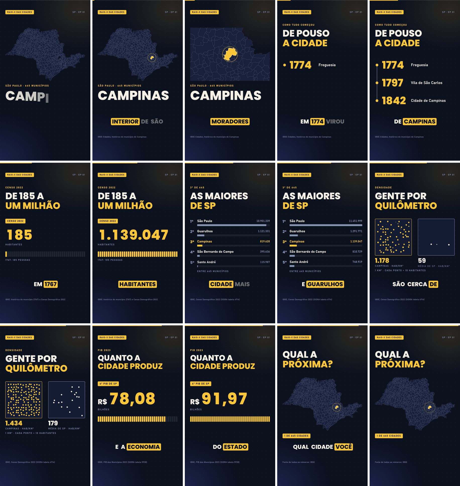

# Protótipo: Raio-X das Cidades (motion graphics por código)

Série de shorts verticais 1080x1920 que explicam uma cidade por episódio: mapa do estado,
marcos históricos, população, ranking, densidade e PIB, com narração, legenda palavra a
palavra e trilha. O formato segue o de séries "explicando todas as cidades do estado"; a
identidade (nome, paleta, layout, textos) é própria.

Protótipo isolado, fora de `src/` e do workspace principal, como `prototypes/motion-remotion`.
Motor e gates de QA vêm da skill `motion-video` (HTML + Chrome headless, cada quadro é função
pura do índice, então o render é reproduzível).



## Um comando por cidade

```bash
cd prototypes/city-motion
npm install
npm run episode -- 3509502            # código IBGE de 7 dígitos -> out/3509502.mp4
npm run episode -- 3552205 --episode 2
```

Requisitos: Node 20+, Chrome estável, ffmpeg, `uv` (roda edge-tts e o gerador de trilha).

## Fluxo

| Passo | Script | Saída |
|---|---|---|
| Dados | `scripts/fetch-city.mjs` | `data/<código>.json`: Censo 2022 (população, área, densidade), PIB municipal mais recente, posição no estado, texto histórico e malha dos municípios, tudo das APIs públicas do IBGE (sem chave) |
| Roteiro | `scripts/draft-episode.mjs` | `episodes/<código>.json`: rascunho só com números do IBGE. Não sobrescreve um roteiro existente |
| Narração | `scripts/narrate.mjs` | edge-tts por cena com tempo de cada palavra; a duração da cena sai da narração, em múltiplos de 0,5 s (120 BPM) |
| Trilha | `scripts/music.py` | trilha procedural original, com os cortes do vídeo |
| Mixagem | `scripts/mix.mjs` | voz na linha do tempo, trilha com ducking, duas passadas de loudnorm (−14 LUFS) |
| Render | `scripts/render.mjs` | H.264 1080x1920, 30 fps, BT.709 |

O rascunho automático cobre qualquer município do Brasil. O que ele não faz é contar a
história: para isso, edite `episodes/<código>.json` usando o texto em `data/<código>.json`
(`history`) e acrescente cenas `timeline`. `episodes/3509502.json` (Campinas) é o exemplo
editado; `episodes/3552205.json` (Sorocaba) é o rascunho automático sem edição.

## Tipos de cena

| `type` | Mostra | `props` |
|---|---|---|
| `map-intro` | estado inteiro, cidade acende, câmera aproxima, nome | — |
| `timeline` | 2 a 4 marcos; cada um entra quando a narração diz o ano | `stops: [{ year, label }]` |
| `counter` | número grande contando + barra segmentada | `to`, `from?`, `fromLabel?`, `decimals?`, `prefix?`, `unit`, `chip`, `cue?` |
| `rank-bars` | maiores municípios do estado em escala linear | `rows`, `rank`, `of`, `selfValue` |
| `density` | dois quadrados de 1 km², um ponto = N habitantes | `city`, `state`, `cityLabel`, `stateLabel` |
| `outro` | mapa, pergunta para os comentários, contagem da série | — |

Toda cena tem `narration` e `source` (a fonte aparece no rodapé). Cena nova: um arquivo em
`src/scenes/` registrado em `src/scenes/index.js`; `sceneFrame` entrega título, área livre
de 952x640, legenda e fonte.

## Verificado no episódio de Campinas

- Números conferidos na resposta da API do IBGE: 1.139.047 habitantes (Censo 2022), 3ª de 645,
  1.433,54 hab/km² contra 178,9 do estado, PIB 2023 de R$ 91,97 bi (4º do estado).
- 1767 (185 pessoas), 1774, 1797 e 1842 vêm do histórico do IBGE Cidades.
- `ffprobe`: h264, 1080x1920, 30 fps, bt709, 2130 quadros em 71 s; áudio e vídeo começam em 0.
- Áudio: −14,1 LUFS, pico −1,4 dBFS. Medido, não ouvido: pronúncia da voz e gosto da trilha
  precisam de um ouvido humano.
- Sem trecho parado de 3 s; quadro inicial não é vazio; mesmo quadro renderizado duas vezes dá o mesmo hash.

## Limitações

- Só cenas de dados. Não há fotos, pessoas famosas, recriações 3D nem clubes de futebol: isso
  exige imagens licenciadas e fatos com fonte por cidade.
- Histórias (cenas `timeline`) são escritas à mão; gerar o roteiro a partir do `history` com o
  LiteLLM do projeto é o próximo passo natural.
- Não está ligado ao CLI, à fila nem ao upload; a saída é local.
- Fontes do sistema (Bahnschrift) nos rótulos: em Linux a largura muda. Poppins ExtraBold (OFL)
  vai junto em `src/fonts/`.
- O texto da narração com números depende de como o edge-tts lê pt-BR ("1.139.047").
